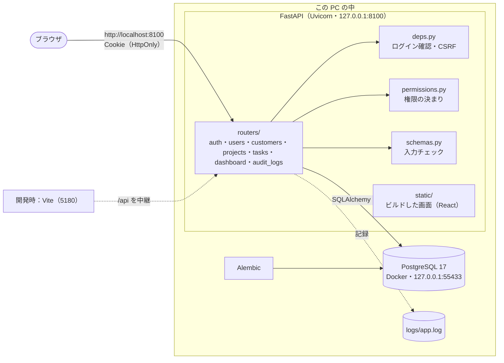
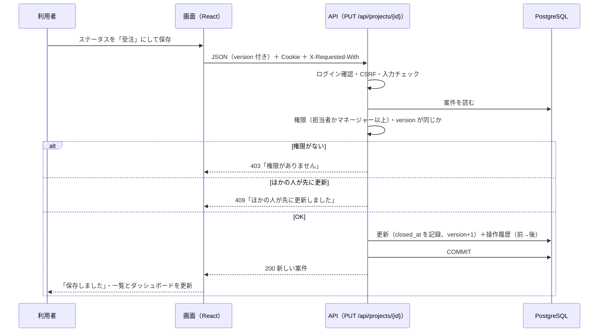

# 02 基本設計書

## 1. 技術構成図



- 画面（React）は API を `fetch` で呼ぶだけで、業務のルールは持たない。権限・入力チェック・ステータスの決まりは API 側
- 本番の形では、ビルドした画面を FastAPI が同じアドレスで返す（Cookie を同じサイトで使える。CORS は許可しない）

## 2. 画面一覧

| 画面 | URL | 対象 | 主な部品 |
| --- | --- | --- | --- |
| ログイン | /login | 全員 | メール・パスワード、失敗の理由、明るさ |
| ダッシュボード | / | 全員 | 数字のカード 5 つ、自分のタスク、締める予定の案件、ステータス別金額・月別受注金額のグラフ、最近の動き |
| 顧客の一覧 | /customers | 全員 | 検索、業種・担当者・並び順、表、ページ送り、追加 |
| 顧客の詳細 | /customers/:id | 全員 | 基本情報、案件の一覧、変更・削除（権限があるときだけ）、案件の追加 |
| 案件の一覧 | /projects | 全員 | ステータスのチップ、検索、担当者・並び順、一覧／ボード切り替え |
| 案件の詳細 | /projects/:id | 全員 | ステータスの進み具合、案件の情報、タスクの表、この案件の履歴（マネージャー以上） |
| タスク | /tasks | 全員 | 自分のタスク・期限切れだけ、状態・担当者・並び順、期間（開始 → 期限）、「完了にする」ボタン |
| チームの状況 | /team | 管理者・マネージャー | メンバーごとのタスクの数と報告、遅れそう・期限切れ・止まっているタスク |
| 予定表 | /schedule | 全員 | 案件とタスクのガントチャート（1 か月／3 か月、担当者、受注・失注の表示） |
| ユーザー | /users | 管理者 | 権限の説明、一覧、追加・変更・パスワード再設定 |
| 操作履歴 | /audit | マネージャー以上 | 内容・人・操作・対象・期間で絞り込み、変わった項目の前と後 |
| 設定 | /settings | 全員 | アカウント、パスワード変更 |

## 3. 画面のレイアウト

```
┌──────────────┬───────────────────────────────────────────────┐
│ ■ 顧客・案件管理 │ こんにちは、佐藤 健一 さん                                  │
│  CRM          │ 今日の営業の様子です。…                                       │
│ ▦ ダッシュボード │ ┌顧客┐┌進行中の案件┐┌見込み金額┐┌今月の受注┐┌期限切れ┐      │
│ 営業          │ └──┘└──────┘└─────┘└─────┘└────┘      │
│  ▤ 顧客        │ ┌あなたのタスク──────┐┌30日以内に締める案件────┐       │
│  ▭ 案件        │ │⚠期限切れ／⏱7日以内 ││ 案件・顧客・状態・金額   │       │
│  ☑ タスク      │ └──────────────┘└──────────────┘       │
│ 管理          │ ┌ステータス別（金額）┐┌月別の受注金額（6か月）┐            │
│  👥 ユーザー    │ └──────────────┘└──────────────┘       │
│  ↺ 操作履歴    │ ┌最近の動き（タイムライン）──────────────────┐       │
│  ⚙ 設定        │ └──────────────────────────────┘       │
│ ☾ ダークモード   │                                                          │
│ (佐) 佐藤 健一   │                                                          │
│ ⇥ ログアウト    │                                                          │
└──────────────┴───────────────────────────────────────────────┘
```

- 各ページは「見出し → 一文の説明 → 絞り込み → 表／カード → ページ送り」の順にそろえる
- 状態は色だけでなく文字のバッジでも表す（受注＝緑、失注＝赤、交渉中＝黄、提案中＝青、見込み＝灰）
- 入力はダイアログ（Esc や背景のクリックで閉じる）。削除はブラウザの confirm() ではなく確認ダイアログ
- 完了は右下のお知らせ、入力の誤りは項目の下、それ以外の失敗は赤い枠で表示
- 幅 760px 以下：メニューは左から出る引き出し、表は横にスクロール、フォームは 1 列
- 権限のない操作のボタンは出さない（API 側でも必ず判定する）

## 4. 権限

[05 詳細設計書](05_詳細設計書.md) の 3 章と同じ表。判定は `backend/app/permissions.py` の 1 か所で行い、
API の返事に `can_edit`・`can_delete`・`can_reopen` を付けて、画面のボタンの表示に使う。

## 5. 処理の流れ（案件を受注にする）


