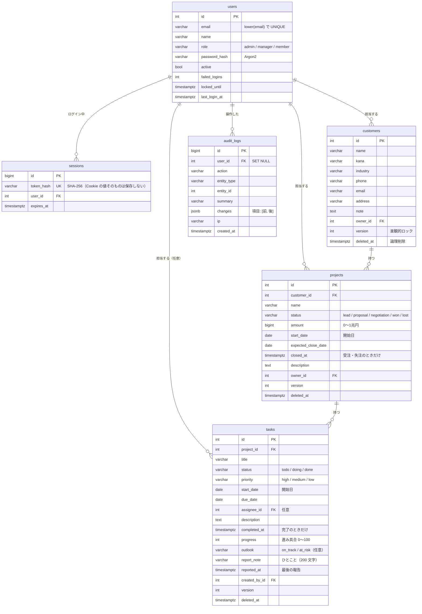

# 03 DB 設計書

DB：PostgreSQL 17。定義は `backend/app/models.py`、作成・変更は Alembic（`backend/migrations/`）。日時はすべて `timestamptz`（UTC で保存し、画面で日本時間にする）。

## 1. ER 図

（全テーブルに created_at、users・customers・projects・tasks には updated_at もある）

## 2. 制約

| テーブル | 制約 | 目的 |
| --- | --- | --- |
| users | `UNIQUE (lower(email))` | 大文字小文字違いの同じメールを 2 人に付けない |
| users | `CHECK role IN (...)`、`failed_logins >= 0` | 知らない権限を入れない |
| sessions | `token_hash UNIQUE`、`ON DELETE CASCADE` | ユーザーを消したらセッションも消える |
| customers | `CHECK length(btrim(name)) > 0` | 空白だけの名前を入れない |
| projects | `CHECK status IN (...)`、`amount BETWEEN 0 AND 1兆` | 値の範囲 |
| projects | `CHECK (status IN ('won','lost')) = (closed_at IS NOT NULL)` | 受注・失注なら閉じた日時が必ずあり、それ以外ならない |
| tasks | `CHECK status IN (...)`、`priority IN (...)` | 値の範囲 |
| tasks | `CHECK (status = 'done') = (completed_at IS NOT NULL)` | 完了なら完了日時が必ずある |
| projects | `CHECK expected_close_date IS NULL OR expected_close_date >= start_date` | 受注予定日が開始日より前にならない |
| tasks | `CHECK due_date IS NULL OR due_date >= start_date` | 期限が開始日より前にならない |
| tasks | `CHECK progress BETWEEN 0 AND 100`、`outlook IS NULL OR outlook IN ('on_track','at_risk')` | 進み具合と見通しの範囲 |
| 外部キー | 顧客・案件・タスク・ユーザーは `ON DELETE RESTRICT` | つながっているものを消して履歴が読めなくなるのを防ぐ（削除は論理削除） |
| audit_logs | user_id は `ON DELETE SET NULL` | ユーザーを消しても履歴は残す |

## 3. インデックス

| インデックス | 使うところ |
| --- | --- |
| customers(owner_id)、projects(customer_id)、projects(owner_id)、tasks(project_id)、tasks(assignee_id)、sessions(user_id) | 外部キーで絞り込む・つなぐ |
| customers(name) WHERE deleted_at IS NULL | 顧客の一覧 |
| projects(status) WHERE deleted_at IS NULL | ステータスの絞り込み・ダッシュボード |
| tasks(due_date) WHERE deleted_at IS NULL AND status <> 'done' | 期限切れ・期限の近いタスク |
| audit_logs(created_at)、audit_logs(entity_type, entity_id)、audit_logs(user_id) | 操作履歴の検索・案件ごとの履歴 |

## 4. 設計の考え方

| 決めたこと | 理由 |
| --- | --- |
| 削除は `deleted_at` を入れる論理削除 | 操作履歴から「何を消したか」を追える。誤って消しても DB には残る |
| `version` 列で楽観的ロック | 同時に開いた 2 人が保存しても、後の人が先の変更を黙って消さない（409 で知らせる） |
| 金額は円の整数（bigint） | 小数の誤差を出さない |
| 状態と日時の整合を CHECK で守る | API の不具合や直接の SQL でも、おかしなデータが入らない |
| 操作履歴の changes は JSONB | テーブルごとに項目が違っても 1 つの表に記録できる |
| セッションは DB に保存（トークンの SHA-256） | ログアウト・パスワード変更・権限変更で、すぐにログインを切れる。DB が漏れても Cookie を作れない |

## 5. マイグレーションの履歴

| 版 | 内容 |
| --- | --- |
| d14f10b9ff7b | 最初のテーブル |
| a3c5e7f9b201 | 案件・タスクに開始日（start_date）を追加。今あるデータは作った日（日本時間）で埋め、終わりの日より後なら終わりの日にする。開始日の CHECK を追加 |
| c7d9e1f3a405 | タスクに報告の列（progress・outlook・report_note・reported_at）を追加。完了のタスクは 100% にする。CHECK を追加 |
